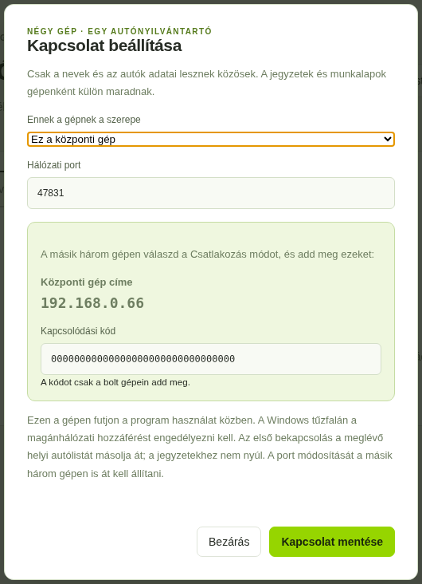
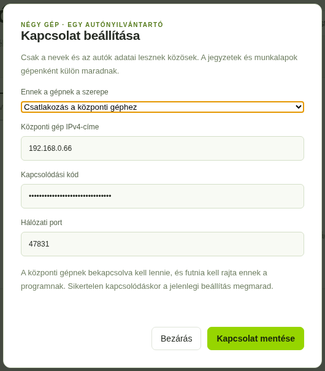
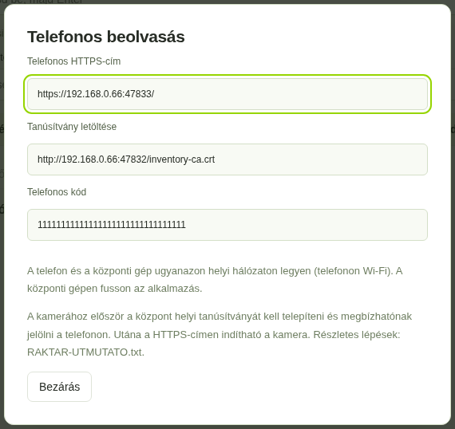
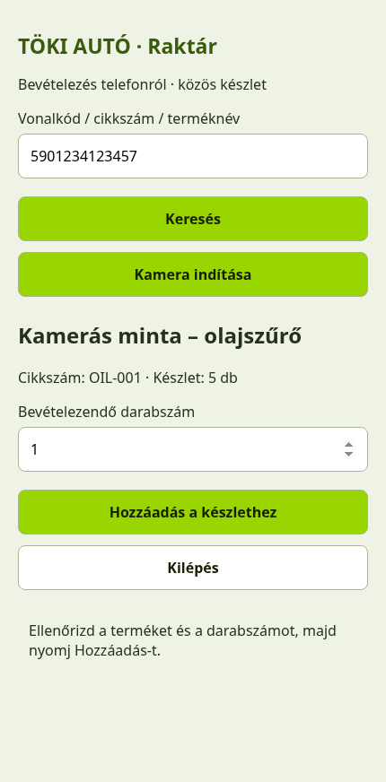
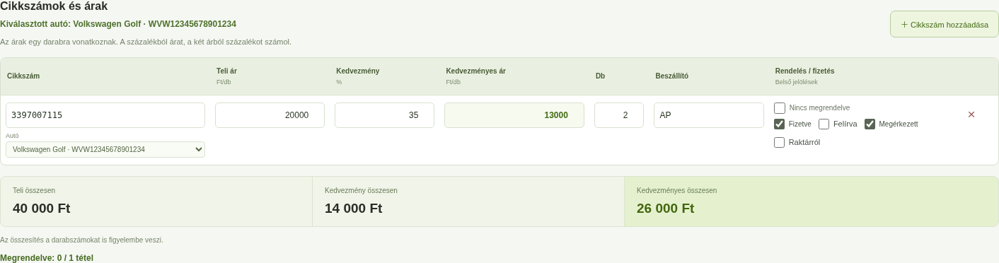

# Töki Autó · képes összekapcsolási útmutató

Négy gép közös autónyilvántartóval és raktárral, telefonos vonalkód-beolvasással. A saját jegyzetek és munkalapok gépenként külön maradnak.

**A képeken példaadatok vannak. A 192.168.0.66 cím, a 000… és 111… kód nem másolandó be automatikusan! A saját főgéped címét és kódjait használd.**

A három másik számítógép és a telefon a főgéphez kapcsolódik. A gépek kábelen, a telefon ugyanahhoz a helyi hálózathoz tartozó Wi-Fi-n legyen. A főgépnek bekapcsolva kell lennie, és futnia kell rajta az alkalmazásnak. A vendég-Wi-Fi gyakran elkülöníti az eszközöket.

**Előkészület: mind a négy gépen az 1.14.0-s vagy újabb, azonos verzió fusson.** Zárd be a régi programot, csomagold ki a friss ZIP-et, és indítsd a TokiAuto-Inditas.cmd fájlt.

Ha a négy gép autónyilvántartója már működik közösen, az 1–2. lépésnél csak ellenőrizd az adatokat; nem kell új kapcsolatot létrehozni. Ezután a 3. lépéstől folytasd.

**1. A FŐGÉP**

Nyisd meg: Autónyilvántartó → Kapcsolat beállítása.

- Szerep: Ez a központi gép.
- Hálózati port: alaphelyzetben 47831. A már működő egyéni portot tartsd meg.
- Kapcsolat mentése.
- Jegyezd fel a megjelenő Központi gép címe és Kapcsolódási kód adatokat.



**2. A MÁSIK HÁROM GÉP**

Mindegyiken nyisd meg: Autónyilvántartó → Kapcsolat beállítása.

- Szerep: Csatlakozás a központi géphez.
- IPv4-cím: az 1. lépésben látott főgép címe.
- Kapcsolódási kód: a főgép Kapcsolódási kódja.
- Port: ugyanaz, mint a főgépen, alaphelyzetben 47831.
- Kapcsolat mentése.

Ezek a gépek nem lesznek külön központok. Ugyanazt az egy főgépet add meg mindháromnál.



**3. A RAKTÁR INDÍTÁSA ÉS A FŐGÉP TŰZFALA**

A főgépen nyisd meg egyszer a Raktár / leltár fület. Ez bekapcsolja a raktárszolgáltatást; későbbi programindításkor magától elindul. A raktár a már beállított központi kapcsolatot követi. A többi gépen is nyisd meg a Raktár / leltár fület.

Csak a főgépen: Start → írd be: PowerShell → jobb kattintás → Futtatás rendszergazdaként → Igen. Másold be az alábbi sort, majd Enter:

```powershell
New-NetFirewallRule -DisplayName "Toki Auto - raktar" -Direction Inbound -Action Allow -Protocol TCP -LocalPort 47832,47833 -RemoteAddress LocalSubnet -Profile Any
```

Ez az alapbeállításhoz szükséges két új bejövő portot engedélyezi a helyi hálózatnak. A korábbi autónyilvántartó-szabályt hagyd meg! Ha az autólista portja nem 47831, a raktár az általad használt port+1, a telefon az általad használt port+2 porton működik; a parancsban is ezeket add meg.

Ha „A hozzáférés megtagadva” jelenik meg, a PowerShell nem rendszergazdaként indult. Zárd be, és a fenti módon nyisd meg újra.

**4. A TELEFON CÍME ÉS SAJÁT KÓDJA**

A főgépen: Raktár / leltár → Telefonos beolvasás.

Ebben az ablakban három adatot találsz: a telefonos HTTPS-címet, a tanúsítvány letöltési címét és a Telefonos kódot. A telefonos kód különbözik az autónyilvántartó kapcsolódási kódjától. A telefonon ezt a külön Telefonos kódot kell használni.



**5. A TELEFON EGYSZERI TANÚSÍTVÁNYBEÁLLÍTÁSA**

Kapcsold a telefont a bolti Wi-Fi-re. A böngészőjében nyisd meg a 4. lépés Tanúsítvány letöltése címét. Töltsd le az inventory-ca.crt fájlt. Csak a saját főgéped által létrehozott helyi tanúsítványt telepítsd.

**Android:** Beállítások → Biztonság / Adatvédelem → További biztonsági beállítások → Titkosítás és hitelesítő adatok → Tanúsítvány telepítése → CA-tanúsítvány. Válaszd a letöltött inventory-ca.crt fájlt. A menüpontok neve Samsungon, Xiaomin és más telefonokon eltérhet; a beállítások keresőjében kereshetsz a „tanúsítvány” szóra.

**iPhone / iPad:** a letöltött tanúsítvány profilját telepítsd a Beállítások → Általános → VPN és eszközfelügyelet részen. Ezután Általános → Infó → Tanúsítvány-megbízhatósági beállítások alatt engedélyezd a „Toki Auto helyi raktar CA” teljes megbízhatóságát. Ha nincs letöltött profil, előbb nyisd meg a letöltött fájlt a Fájlok appban. A menüpontok iOS-verziónként eltérhetnek.

A kamera használata előtt a saját HTTPS-oldalnak tanúsítványfigyelmeztetés nélkül kell megnyílnia. A figyelmeztetés egyszerű átugrása nem helyettesíti a tanúsítvány megbízhatóságának beállítását.

**6. BELÉPÉS ÉS BEOLVASÁS A TELEFONON**

Chrome-ban vagy Safariban nyisd meg a főgép által mutatott Telefonos HTTPS-címet. Írd be a 4. lépésben látott Telefonos kódot, majd Kapcsolódás.


Nyomd meg: Kamera indítása → engedélyezd a kamerát → mutass rá a vonalkódra. A kamera egy kód után megáll. Ellenőrizd a felismert terméket és a darabszámot, majd Hozzáadás a készlethez.



Ismeretlen vonalkódnál először terméknév és cikkszám kell. Terméknévre, cikkszámra és vonalkódra kézzel is kereshetsz. Válaszvesztésnél a Függő művelet újrapróbálása gombot használd.

**7. EGY RÖVID KÖZÖS PRÓBA**

- A főgép Raktár részében hozz létre egy próba terméket a saját cikkszámával és vonalkódjával.
- Telefonról vételezz be belőle 1 darabot.
- A másik számítógép Raktár részében nyomj Frissítést. Ugyanannak a terméknek ugyanazt a készletet kell látnod.
- A jegyzet egyik tételsorába írd be ezt a cikkszámot, darabszámnak 1-et, és pipáld be: Raktárról. Várd meg a sikeres mentést: a készlet 1-gyel csökken.
- Vedd ki a Raktárról pipát, és várd meg a mentést: az 1 darab visszakerül.



**Ha nem kapcsolódik:** ellenőrizd, hogy fut-e a főgépen az alkalmazás, a saját aktuális IPv4-címét adtad-e meg, a telefon a megfelelő Wi-Fi-n van-e, és a két új portot a főgépen engedélyezted-e. „Helyi próbakészlet” esetén az adott gép autónyilvántartó-kapcsolatát is be kell állítani. A telefonon a saját HTTPS-címet és a külön Telefonos kódot használd.

A jegyzetek és munkalapok továbbra is a saját gépükön maradnak; közös az autónyilvántartó és a raktár.
