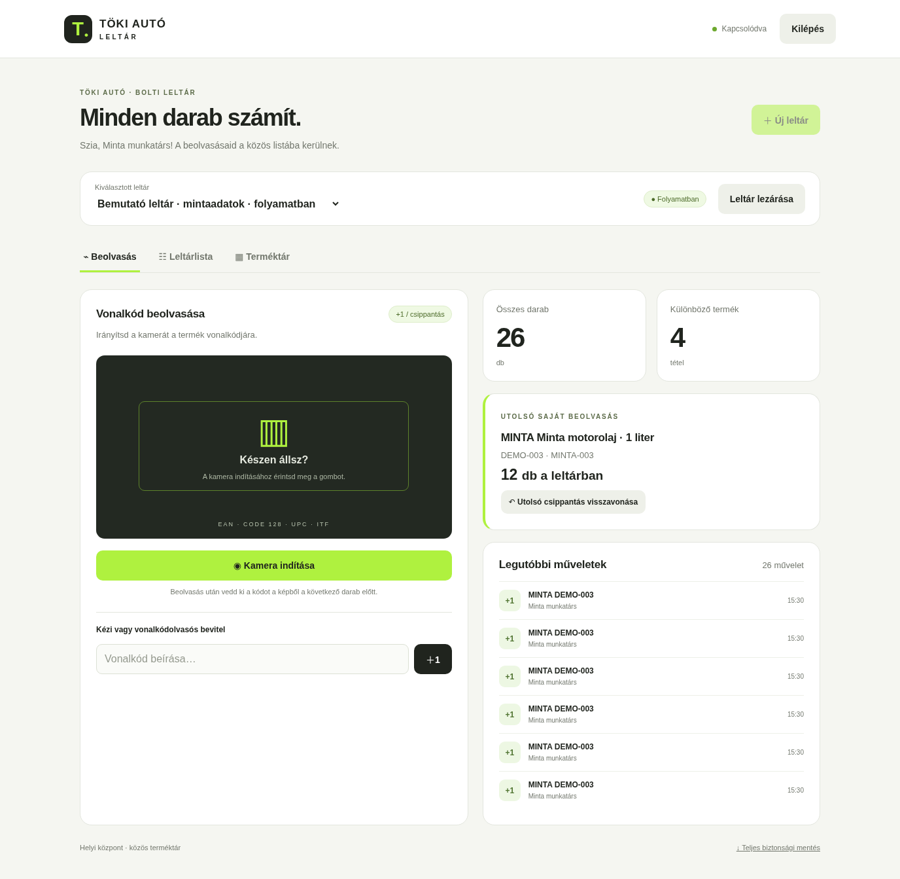
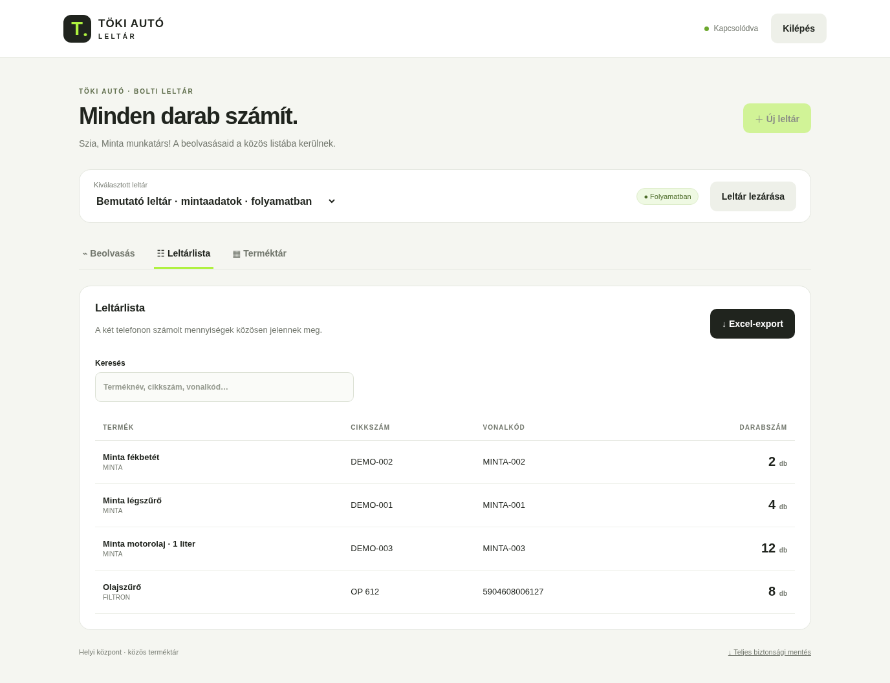

# Töki Autó Leltár – képernyőképek

A ténylegesen futó felületről készített képernyőképek elkülönített mintaadatokat mutatnak. A 26 darab, a mintatermékek és a munkatárs neve bemutatóadatok. A képek megnyitásához nem kell a leltárprogramot telepíteni vagy elindítani. Ezek nem jelentenek Windows Defender-vizsgálatot vagy vírusmentességi igazolást.

## Számítógépes beolvasási felület

## Leltárlista számítógépen

## Telefonos nézetek

[Beolvasási felület telefonon](leltar-telefon.png) · [Leltárlista telefonon](leltarlista-telefon.png)

A mobilos táblázat vízszintesen görgethető, a további oszlopok jobbra találhatók. A kameraterület a még el nem indított kamera állapotát mutatja.
